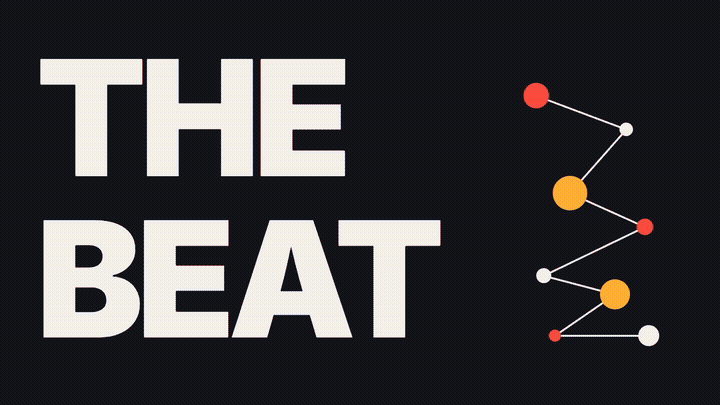

# Taal Motion showreel (code)

The source of the Taal Motion showreel: a 47.5 s, 1920 x 1080 film built entirely in HTML, GSAP and Three.js and rendered frame by frame with [HyperFrames](https://hyperframes.heygen.com).

## What's inside
- **Cut to the beat.** The track runs at 114 BPM; every scene boundary and hit is placed on a beat frame (`fb x 15.79` frames at 30 fps). Each 4-bar phrase is one 16-beat teentaal cycle, and cobalt only fills the frame on *sam*, its first beat.
- **Extruded 3D type** from real font outlines (`assets/js/glyphs.js`, `assets/js/kit.js`).
- **A small 3D Bauhaus set** (half-discs, quarter circles, arches, rings, cones, stacks) with studio lighting, all drawn through one shared WebGL renderer.
- **Kinetic type:** slot rolls, letter drops with squash, waves, slams, a knockout that plays video inside letters.
- **2D Bauhaus motion:** stripes, eye-rings, chevrons, constellations and a perspective-bar tunnel, all driven by timeline time so every frame is deterministic.

## Structure
- `index.html`: the root timeline (scenes and sound effects)
- `compositions/`: one file per scene
- `assets/js/kit.js`: palette, easing, the 3D shape set and 3D text

## Not included
The music (licensed, not redistributable) and the portfolio video clips are left out, so the film plays without them here. The fonts are Inter and Inter Tight (SIL Open Font License).

*All pieces shown are Taal Motion concept and studio work.*
